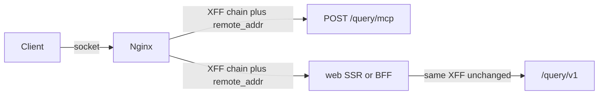

# query-api GeoIP lookups

In-process MaxMind **GeoLite2-City** lookups for country and approximate coordinates. The MMDB is **not** loaded from Postgres. `geoipupdate` writes the file; query-api maps it read-only and keeps a `maxmind` reader in memory (~70 MB per process).

**Back:** [overview](overview.md)

## Layout

| Piece | Role |
|-------|------|
| `geoipupdate` Compose service (`profiles: ["geoip"]`) | Downloads GeoLite2-City into a volume every 72 hours |
| Named volume `geoip_data` (prod/staging/manual) | Shared file at `/usr/share/GeoIP/GeoLite2-City.mmdb` |
| Infra bind-mount `./data/geoip` | Host `pnpm nx serve query-api` reads the same file |
| `GeoipReaderService` | Opens MMDB, watches for replace, retries on `ENOENT` |
| `GeoipLookupService.lookup(ip)` | Country + lat/lon + `accuracy_radius` |
| `resolveClientIp` / `ReqClientIp` | Client IP after Express `trust proxy` |

Enable geoipupdate with `MAXMIND_ACCOUNT_ID` and `MAXMIND_LICENSE_KEY`. Locally start **infra**, not the apps stack:

```bash
docker compose -f docker-compose.infra.yml --profile geoip up -d
```

Without keys, omit `--profile geoip`; query-api starts with lookups disabled.

Pin: `ghcr.io/maxmind/geoipupdate:v8.0.0` (not `:latest`). stack-watchdog pull/up includes `geoipupdate` only when `COMPOSE_PROFILES` contains `geoip`.

## Env

| Variable | Local (`nx serve`) | Docker query-api |
|----------|--------------------|------------------|
| `GEOIP_DB_PATH` | `data/geoip/GeoLite2-City.mmdb` | `/usr/share/GeoIP/GeoLite2-City.mmdb` |
| `TRUST_PROXY` | `0` | `1` |

`TRUST_PROXY` is a **hop count**, never `true`.

| Topology | Value |
|----------|-------|
| `nx serve` on the host | `0` |
| nginx in front of query-api (default stack) | `1` |
| CDN/LB in front of nginx (Cloudflare, ALB) | `2` |

## Client IP

nginx `$proxy_add_x_forwarded_for` appends `$remote_addr` at the **end**. Left-hand hops can be forged. Express `trust proxy = N` uses the N-th address from the right as `req.ip`.



- **REST / MCP:** `resolveClientIp(req)` → `normalizeClientIp(req.ip)`. Do not parse `X-Forwarded-For` by hand.
- **Web:** opt-in `queryApiFetch({ forwardClientIp: true })` copies the incoming `X-Forwarded-For` **verbatim**. Default is false so RSC pages stay cacheable (`headers()` is dynamic). Object-page `POST /query/v1/objects/resolve` sets the flag. Do not take the left-most hop and do not read `x-real-ip` (that is the edge with a CDN).
- **MCP:** `McpRequestContext.clientIp` comes from the HTTP request, not from tool arguments. That IP is the **agent runtime** (often a datacenter). Do not treat MCP geo as browser geo (affiliate, maps).

Prod nginx publishes `/query/mcp` only. A self-hosted `/query/` location uses the same hop rule.

## Lookup mapping

- `countryCode`: `country.iso_code`, else `registered_country.iso_code`
- `latitude` / `longitude` / `accuracyRadiusKm` from `location`
- Invalid IP or missing MMDB row → `null`

When there is no city, MaxMind still returns a point (often a country centroid) with a large `accuracy_radius` (100–1000 km). Consumers must send `accuracyRadiusKm` and must not draw a precise pin.

## Degradation

- Missing `GEOIP_DB_PATH`: one log, lookups disabled, process stays up.
- Missing file (`ENOENT` on a fresh volume): one warn, retry every 60s, process stays up.
- `watchForUpdates` + `watchForUpdatesNonPersistent`: atomic rename from geoipupdate reloads the reader without a process restart.

## Attribution

This product includes GeoLite2 data created by MaxMind, available from [https://www.maxmind.com](https://www.maxmind.com).

## Verification

| Command | Purpose |
|---------|---------|
| `pnpm nx test query-api` | Unit / Express hop tests |
| `pnpm nx serve query-api` | Log `GeoIP database loaded from …` after the MMDB exists |

Related code: `apps/query-api/src/domain/geoip/`, `apps/query-api/src/http/client-ip.ts`.
