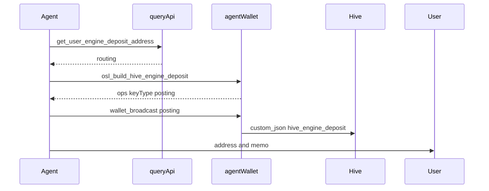

# Hive Engine deposits for agents

Read deposit routing via **query-api MCP**; persist a **deposit instruction** via **agent-wallet** (`osl_build_hive_engine_deposit` + `wallet_broadcast` posting); then tell the user where to send funds.

The instruction is an OSL audit row in ENGINE history (`kind: deposit_instruction`). It does **not** move BTC/HIVE and does **not** credit `SWAP.*`. Hive Engine converter credits `SWAP.*` after external confirmations.

## When to use

- User asks where to send **BTC / LTC / HBD / HIVE** so an account receives **SWAP.BTC / SWAP.LTC / SWAP.HBD / SWAP.HIVE**.
- Agent must expose a deposit address **and** leave a checkable row in wallet history.

## When not to use

- Engine AMM swaps or withdraws — [wallet-delegation-swap-for-agents.md](wallet-delegation-swap-for-agents.md).
- Hive L1 liquid transfers unrelated to Hive Engine pegged deposits.

## MCP servers

| Server | Role |
|--------|------|
| **query-api** `POST /query/mcp` | `get_user_engine_deposit_list`, `get_user_engine_deposit_address`, `get_user_engine_wallet_history`, `get_user_engine_wallet` |
| **agent-wallet** `POST /agent-wallet/mcp` | `osl_build_hive_engine_deposit`, `wallet_broadcast` (`keyType: posting`) |
| **knowledge-api** | This skill + swap/deposit specs |

## Authority

| Operation | Tool | Chain auth | `wallet_broadcast` keyType |
|-----------|------|------------|----------------------------|
| Deposit instruction | `osl_build_hive_engine_deposit` | posting | `posting` |
| HIVE L1 send after instruction | no MCP builder yet | active | `active` (hand-built `transfer`) |

## Must (order)

1. `wallet_status` — posting key for `account` is ready.
2. Optional: `get_user_engine_deposit_list({ account })` for depositable symbols.
3. `get_user_engine_deposit_address({ account, symbol })` — e.g. `BTC`. **503** = converter down: do not invent an address, do not broadcast.
4. `osl_build_hive_engine_deposit({ account, routing })` — pass the **entire** address-tool result as `routing`. `routing.account` is the Hive Engine swap account (e.g. `honey-swap`), **not** the user.
5. `wallet_broadcast({ ops, keyType: "posting", account })` → poll `wallet_broadcast_status`. **One broadcast per routing** (repeats duplicate history).
6. **Then** show the user `routing.address` and/or `routing.account` + `routing.memo`.
7. If broadcast failed, you may still give the address, but say there is **no** history row.

Do not show the address before step 6 except the failed-broadcast case in step 7.

## What to tell the user

- Send any amount of `{symbol}` to the returned address (BTC/LTC) or Hive account+memo (HIVE).
- `SWAP.{symbol}` is credited by **Hive Engine converter** after required confirmations. Do not promise a deadline.
- Instruction ≠ credit. History shows the address/memo/rate; the inbound `SWAP.*` is a later RPC row.

## HIVE (hivepegged)

After the instruction, send **HIVE** on Hive L1 to `routing.account` with `routing.memo` (active key). There is no `hive_build_transfer` MCP tool — hand-build a `transfer` op or tell the user to send from a wallet.

## Verify

1. `get_user_engine_wallet_history` — row `kind: deposit_instruction` / `operation: hive_engine_deposit` with matching address/memo/rate (indexer lag: seconds).
2. After converter settlement: `get_user_engine_wallet` for `SWAP.*` balance.

## Flow

## Verification

- `pnpm nx test hive-broadcast --testPathPatterns=osl-operations`
- `pnpm nx test agent-wallet --testPathPatterns=hive-engine-deposit`
- `pnpm nx test query-api --testPathPatterns=deposit`
- query-api MCP `tools/list` includes `get_user_engine_deposit_list` and `get_user_engine_deposit_address`
